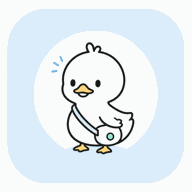
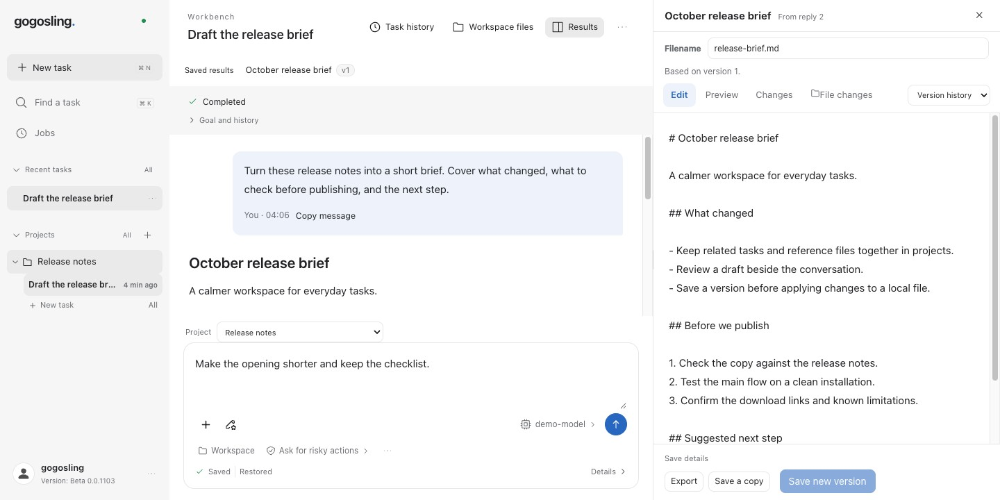
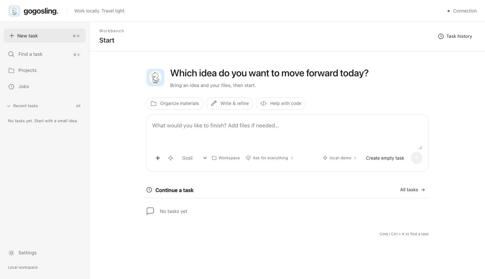
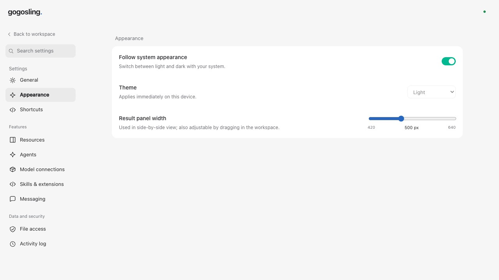

<p align="center"></p>
<h1 align="center">gogosling</h1>
<p align="center"><strong>Bring the brief. Leave with a file.</strong></p>
<p align="center">Read documents, write drafts, and review code changes.<br>Keep the conversation beside the work, with projects saved on your machine.</p>

<p align="center">
  <a href="https://github.com/GoGoslingCA/gogosling/actions/workflows/ci.yml"></a>
  <a href="LICENSE"></a>
  <a href="https://gogosling.ca"></a>
</p>
<p align="center">
  <a href="#run-it">Run it</a> · <a href="docs/README.md">Docs</a> · <a href="ROADMAP.md">Roadmap</a> · <a href="CONTRIBUTING.md">Contribute</a>
</p>

**An open-source desktop AI workspace, developed by [Gogosling.ca](https://gogosling.ca), a Canadian company.** Bring your own model connection. No gogosling account required.

> **Beta:** run from source or build a desktop package. Signed installers are still on the [roadmap](ROADMAP.md).



*Actual app, synthetic demo content, local test model. This shows the workflow, not a model-quality benchmark.*

## Keep your work in reach

- **Read beside the conversation.** Open a document or code file in the results pane while asking for changes.
- **Pick the context.** Group files and tasks into projects. Choose which materials a task should reference.
- **Read document text through tools.** An enabled agent can extract bounded passages from DOCX, slides, spreadsheets, and text files in its permitted workspace, with source positions and file-version checks.
- **Keep a draft you can return to.** Edit text, save versions, copy, and export. Resume a task from the sidebar.
- **Check a file edit before applying it.** Inspect the diff, apply through the permission checks, and undo supported text-file changes. External edits trigger conflict checks.

<details>
<summary>See the start page and settings</summary>





The interface supports English, French, and Simplified Chinese. Model connections, tools, permissions, and resource limits live in Settings.

</details>

## Run it

For the source workflow, install **Go 1.26, Node.js 22 LTS (22.12+), Python 3.12, uv, Git, and make**. Use Bash on macOS/Linux, or WSL2 for Web development on Windows.

```bash
git clone https://github.com/GoGoslingCA/gogosling.git
cd gogosling
npm ci
uv sync --project worker --frozen --python 3.12
make dev
```

In a second terminal, from the same checkout:

```bash
npm run dev -w @gogosling/web -- --strictPort
```

1. Open **http://127.0.0.1:5173**. Leave the connection address empty and enter the `token` from your local `~/.gogosling-dev/daemon.json`. Keep that file private; the browser holds the token only in memory.
2. In **Settings → Model connections**, add and test a provider.
3. In **Settings → Agents**, create an agent from a bundled template or choose Custom, then select its model. Start a task or create a project from the sidebar.

[Setup and troubleshooting →](docs/development/quickstart.md)

<details>
<summary>Build a desktop package</summary>

With the build prerequisites installed on the target OS and architecture:

```bash
npm run package -w @gogosling/desktop
```

The package includes the daemon, Python runtime, worker, and UI. Users do not need separate Go, Node, Python, or uv installations. Build outputs are unsigned and saved in `apps/desktop/release/`; configure a model after launch. See the [desktop guide](apps/desktop/README.md) for native build prerequisites and platform limits.

</details>

## Three things to try

- **Turn requirements into a plan.** Use a Markdown requirements file or paste a brief. Draft a plan, then edit it beside the conversation.
- **Review a code change.** Ask for revised file content, save it as a result, then preview and approve the change to one text file.
- **Prepare a project brief.** Read a slide deck in the preview pane, supply the key text, and draft a one-page brief to edit and export.

## What makes this workspace different

**Projects have a place of their own.** Reopen the files, tasks, and saved results together. The latest draft stays within reach when the conversation gets long.

**The model is your choice.** Connect an OpenAI-compatible endpoint, Anthropic Messages, or a compatible local model server. Remote models receive the context you send and may charge for requests. Local storage does not mean every model request stays on the device.

**Concurrency has a limit.** By default, two tasks run at once and up to 32 wait in the queue. Tasks sharing a workspace run in order. File viewers load when opened; idle MCP connections are released. We have not published comparative memory or energy benchmarks; [help us measure them](ROADMAP.md#help-measure-the-difference).

## Know the current limits

- Preview Markdown, code, static HTML/SVG, PDF, images, CSV/TSV, modern Office, OpenDocument, archive listings, and browser-supported media. Preview support does not imply model understanding of every format. [Format details →](docs/design/content-preview-architecture.md)
- Office support is for reading, not full Office editing. Legacy formats and layout conversion need optional sandboxed LibreOffice on macOS.
- Guarded text-file apply/undo works on Linux/macOS. Windows retains preview and export. Cross-platform core CI is not a claim of fully validated desktop installers.

## Under the hood

A **Go daemon** owns local state, permissions, and scheduling. A **Python worker** handles inference. **Electron and React** provide the desktop UI; Web and CLI clients use the same local API. Tool calls, including those from scheduled tasks and MCP extensions, pass through the daemon’s permission checks.

[Architecture](docs/development/architecture-guide.md) · [Detailed contracts](docs/architecture.md) · [Development guide](docs/development/quickstart.md)

## Build with us

**PRs are welcome, from Canada and everywhere else.** Help Gogosling.ca build practical open-source AI tools in Canada.

A small contribution counts: reproduce a file-preview bug, fix a keyboard interaction, improve a translation, test setup on a clean machine, or add a resource-usage benchmark.

- [Pick a first contribution](CONTRIBUTING.md#good-places-to-start).
- [Report a bug or request a feature](https://github.com/GoGoslingCA/gogosling/issues/new/choose).
- [Discuss an idea or help maintain a module](https://github.com/GoGoslingCA/gogosling/discussions).
- [Report a security issue privately](SECURITY.md).

## License

[MIT](LICENSE) · [Gogosling.ca](https://gogosling.ca).
