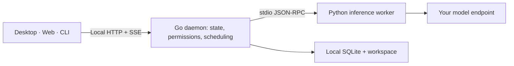

<p align="center"></p>
<h1 align="center">gogosling</h1>
<p align="center"><strong>Work locally. Travel light.</strong></p>
<p align="center">An open-source AI workbench for your files, focused tasks, and reviewable changes.</p>

<p align="center">
  <a href="https://github.com/GoGoslingCA/gogosling/actions/workflows/ci.yml"></a>
  <a href="LICENSE"></a>
  <a href="https://gogosling.ca"></a>
</p>
<p align="center">
  English · <a href="README.zh-CN.md">简体中文</a><br>
  <a href="#try-it">Try it</a> · <a href="docs/README.md">Docs</a> · <a href="ROADMAP.md">Roadmap</a> · <a href="CONTRIBUTING.md">Contribute</a> · <a href="https://github.com/GoGoslingCA/gogosling/discussions">Discuss</a>
</p>

**Developed by [Gogosling.ca](https://gogosling.ca), a Canadian company.** We welcome pull requests from developers everywhere. Help advance open-source AI in Canada with tools that people can inspect, run locally, and improve together.

> **Development preview.** Run from source today. Signed installers and release packaging are on the [roadmap](ROADMAP.md). Expect changes as the project matures.


*Actual development UI in an isolated demo workspace. Interface languages: English, 简体中文, Français.*

## From an idea to a saved result

1. **Bring the material.** Start a task, add a file, and choose the project materials to reference.
2. **Work alongside the result.** Keep the conversation and a document preview side by side. Refine a prompt before sending it.
3. **Review, then save.** Edit a draft, keep a version, export a copy, or inspect a file change before applying it. Undo uses the same permission checks.

Projects, drafts, task history, and result versions live in the local daemon. Desktop, browser, and CLI share that work through a versioned API.

## Built to keep work local and bounded

- **Separate client and engine.** The Go daemon owns state, permissions, and scheduling. A replaceable Python worker handles inference; Electron and React stay clients.
- **Controlled concurrency.** Two running tasks and a 32-item queue by default, configurable parallelism, same-workspace serialization, and cancellation that releases local resources.
- **On-demand viewers.** Preview modules load when opened. Parsing has size, time, and concurrency limits; closing a preview releases its resources.
- **Reviewable changes.** Draft conflict checks, immutable result versions, and guarded text-file apply/undo support recovery.
- **Your model, your tools.** OpenAI-compatible and Anthropic endpoints, compatible local model servers, MCP, extensions, and scheduled tasks.

These are design choices, not a measured claim of lower memory use or higher speed than another product. [Help us build reproducible benchmarks](ROADMAP.md#help-measure-the-difference).

### Read files without leaving the task

View Markdown, text/code, static HTML/SVG, PDF, images, browser-supported audio/video, CSV/TSV, modern Office, OpenDocument, and archive listings.

Office previews emphasize readable content; they are not full Office editors. Legacy Office and layout conversion currently require optional sandboxed LibreOffice on macOS. Other unsupported formats keep a download path. [Format boundaries →](docs/design/content-preview-architecture.md)

<details>
<summary>See the workbench and settings</summary>


English development demo: a synthetic workshop plan and project brief beside the conversation. The isolated local demo contains no personal task history. Sample content illustrates the UI, not model quality.


Models, tools, connections, permissions, and resource controls are grouped in Settings.

</details>

## Try it

Requires **Go 1.26, Node.js 22.12+, Python 3.12, uv, Git, and make**. Use Bash on macOS/Linux, or WSL2 for this development workflow on Windows.

```bash
git clone https://github.com/GoGoslingCA/gogosling.git
cd gogosling
npm ci
uv sync --project worker --frozen --python 3.12
make dev
```

In a second terminal, from the same checkout:

```bash
npm run dev -w @gogosling/web -- --strictPort
```

Open **http://127.0.0.1:5173**. Leave the connection address empty and enter the `token` from your local `~/.gogosling-dev/daemon.json`. Do not share this file; the browser keeps the token only in memory.

In **Settings → Models**, connect your provider, then configure an agent and start a task. Starting the app and running tests do not require a paid model key; real requests may incur provider charges.

[Full setup, Electron launch, and troubleshooting →](docs/development/quickstart.md)

### Current boundaries

- Core CI covers **Linux, macOS, and Windows**; signed installers and full desktop validation are still release work.
- Guarded text-file apply/undo supports **Linux/macOS**; Windows keeps preview and export.
- Local-first describes storage and orchestration. **Remote models receive the context sent to them.** No gogosling cloud account is required.
- HTML previews are static and sandboxed, with external resources blocked. Credentials are stored separately from the application database.

## Architecture you can contribute to



The worker requests tools; the daemon checks permissions and executes them. The UI never opens the database directly. Start with the [English architecture guide](docs/development/architecture-guide.md); the [detailed architecture](docs/architecture.md) defines dependency and safety rules.

## Build with us

**PRs are welcome.** A reproducible bug, clearer setup instructions, a French translation fix, or a small document fixture is a useful contribution.

- [Choose a first contribution](CONTRIBUTING.md#good-places-to-start).
- [Explore the roadmap and maintenance areas](ROADMAP.md).
- [Report a bug or propose an improvement](https://github.com/GoGoslingCA/gogosling/issues/new/choose).
- [Introduce an area you would like to help maintain](https://github.com/GoGoslingCA/gogosling/discussions).
- [Report a security issue privately](SECURITY.md).

Built in Canada, open to everyone. Small, reviewed changes help grow a sustainable Canadian open-source AI community. If this direction is useful to you, a star helps others discover the project.

## License

[MIT](LICENSE) · Developed by [Gogosling.ca](https://gogosling.ca).
