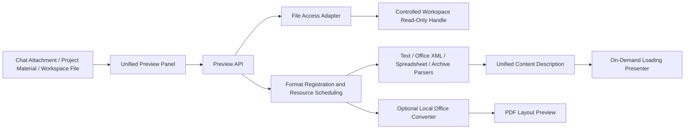

# Local Content Preview Architecture

2026-10-12. Design first, implement later; applicable to Gogosling deliverables and project materials, without changing existing chat, drafts, and P3B file approvals.

## Objectives and Rationale

Click an attachment or deliverable to read, close to release large objects. A unified file entry point and format-specific toolbars support reading while chatting; clearly distinguish between content reading, layout preview, and download-only.

Maintain the existing architecture of Go daemon + React thin client + independent inference worker. File parsing does not occupy model slots, does not invoke AI, and does not send files to the cloud. Parsers and presenters are combined by format, and converters are started only when needed.

## Modules and Dependencies



1. The **Access Layer** only verifies the Agent, workspace path, file identity, and read limits; it does not interpret files. It uses read-only handles constrained by the root directory, rejecting directories, device files, path traversal, out-of-bounds symlinks, and protected paths. HTTP continues to use existing Bearer, Origin, and Host validations. Read-only previews do not expand tool permissions; file writing independently follows existing approvals.
2. The **Parsing Layer** only receives `context.Context`, name, size, and `io.ReaderAt`, outputting bounded pure data; it must not open other files, connect to the network, start models, or write to databases. One module per format.
3. The **Registration and Scheduling Layer** is responsible for suffix/signature identification, format capabilities, unified budgets, cancellation, and error normalization. Explicitly registered, without using reflection, plugin scanning, or background polling. A failure in one format does not trigger blind parsing guesses for other formats.
4. The **Presentation Layer** lazy-loads readers based on the unified `kind`, handling page turning, worksheet switching, source/preview, downloading, refreshing, and error recovery. Only mounts the current file; React error boundaries isolate rendering failures. Panels reuse existing dimensions and narrow-window tabs.
5. The **Conversion Adapter** is optional, handling legacy Office and precise layout requirements. Calls local LibreOffice with fixed parameters, single concurrency, timeout, independent temporary directory, and user configuration, prohibiting macros, external link updates, and the network. When a suitable converter/isolation capability is missing, clearly prompt and retain download; never silently upload for online conversion.

Dependency direction: `app → server / workbench/preview / workspace`; `server → workbench/preview`; `workbench/preview → model/i18n/standard library`. Parsers do not depend on server, store, app, or React; presenters do not reverse-import pages. No new inference protocols or database migrations.

## Directory Structure

```text
internal/workbench/preview/
  types.go          Content description, budget, Parser / Source / Converter interfaces
  service.go        Registration, identification, scheduling, errors, observation
  text.go           Text, Markdown, HTML, code, CSV/TSV
  package.go        General bounded ZIP/XML reading
  word.go           DOCX text segments, tables, embedded images
  slides.go         PPTX slide content, embedded images
  sheets.go         XLSX worksheets, coordinates, cached values
  opendocument.go   ODT/ODS/ODP content
  archive.go        ZIP/TAR/GZIP directory (no disk extraction)
  *_test.go         Synthetic real format packages and malicious boundaries
internal/workspace/preview.go      Secure read-only handle
internal/app/adapters_preview.go   Workspace, optional converter composition
internal/server/handlers_preview.go  Post-auth HTTP adapter
apps/web/src/api/modules/preview.ts  Sole network entry point
apps/web/src/content/
  types.ts / registry.ts           Content contracts and lazy-loading dispatch
  ContentPreview.tsx               General panel and request lifecycle
  viewers/                        Document/spreadsheet/slide/text/HTML/media/PDF/directory
  preview.css / *.test.tsx         Unified styles and behavioral tests
```

Adding formats: Add a parsing module and register the extension/signature/parsing function in the assembly table; reuse existing content descriptions and presenters. Add a new `kind` and lazy-loading presenter only when a completely new interaction type is required, without modifying chat pages or file access layers.

## Interface Conventions

```go
// All are contracts within the preview package, avoiding the expansion of shared storage interfaces.
type Source interface {
    Open(ctx context.Context, agentID, path string) (File, error)
}
type File interface {
    io.ReaderAt
    io.ReadSeeker
    io.Closer
    Stat() (fs.FileInfo, error)
}
type Parser interface {
    Parse(ctx context.Context, input Input) (Document, error)
}
```

`Document` has a fixed `format/kind/name/size`; returns text, blocks, slides, sheets, entries according to kind, accompanied by machine-readable warnings. Text segments are pure text/emphasis/image/table descriptions, without returning executable React or unfiltered HTML. Raw HTML text is passed exclusively to the dedicated isolated renderer.

Workbench contract increments (reusing previously authorized OpenAPI/architecture adjustments):

- `GET /api/v1/agents/{id}/files?path=...`: Bounded directory list, serving as a discoverable entry point for model-generated files.
- `GET /api/v1/agents/{id}/file-preview?path=...`: Content description; reading and parsing are canceled alongside HTTP cancellation.
- `GET /api/v1/agents/{id}/file-content?path=...`: Controlled raw file stream supporting Range; clients obtain Blobs through authenticated APIs without putting tokens in URLs.
- Optional layout conversion separate request, responding with PDF; separated from raw file download.
- `/version` incremental capability `workbench.preview: 1`; hide new entry points if the legacy kernel is absent, leaving existing attachments and deliverables unaffected.

## Format Coverage and Boundaries

- Markdown/MDX (without executing JSX), TXT, logs, source code, JSON/XML/YAML/TOML: reading, code highlighting, source code; UTF-8/UTF-16 BOM, other encodings explicitly reported as errors.
- HTML/HTM, SVG: Isolated preview and source code. Prohibition of scripts, forms, popups, remote resources, and parent page access. Static layouts can be displayed; pages relying on scripts/remote resources will not be disguised as complete applications.
- DOCX/DOTX/DOCM: Paragraphs, headings, tables, embedded images; macros ignored. Complex fields, revisions, and floating layouts are not guaranteed to be pixel-identical with Word.
- PPTX/POTX/PPSX/PPTM: Page turning in original order, text, images; complex masters, animations, and chart objects use visible prompts; optional PDF conversion to supplement layout.
- XLSX/XLTX/XLSM: Worksheet switching, grid, cached values, formula text; formulas/macros/external links are not executed. CSV/TSV use the same grid reader.
- ODT/ODS/ODP: Reuse document, spreadsheet, and slide content descriptions; subject to the same budget limits.
- PDF: On-demand loading of PDF.js and independent worker, page-by-page rendering, single-page canvas up to 4 million pixels; fonts, CMaps, and decoders provided with the client, no CDN access, no scripts, XFA, forms, or embedded attachments enabled. PNG/JPEG/GIF/BMP/WebP/AVIF/ICO: local images; MP3/WAV/OGG/M4A/FLAC/AAC and MP4/WebM/MOV/M4V/OGV: native controls, no autoplay. Display errors and download options when specific codecs are unsupported.
- DOC/PPT/XLS, RTF: Optional local conversion module; explain missing capabilities when conversion is unavailable. RAR/7z and other non-native archives retain recognition and download without claiming extraction; ZIP/TAR/TGZ/GZ provide secure directories/metadata without execution or content write-out.

These are practical capability tiers, avoiding the use of "supports all formats" to cover up corruption, encryption, legacy binaries, proprietary encodings, and complex layout differences.

## Resource and Security Budgets

- Content parsing is single-concurrency with no infinite queues; retriable when busy, without crowding out model execution slots. 10-second limit for ordinary file parsing; 30-second limit for single-concurrency conversion.
- Initial defaults: text 2 MiB, structured documents 32 MiB, raw file preview 64 MiB; ZIP up to 2,000 entries, declared total uncompressed size 64 MiB, single entry 8 MiB. Actual reads are also throttled to prevent forged headers and ZIP bombs.
- Content description limited to 200 pages / 20,000 cells; excess brings clear truncation prompts or rejection, with raw files retained for download. Grids limited to 100 rows per page, slides mount only the current page.
- Close/switch pages to cancel requests, revoke Blob URLs, explicitly pause and unmount audio/video, without background pre-parsing, persistent body caching, or writing to thumbnail libraries. Long text is paginated at 60,000 characters, long Markdown uses paginated source code, and documents and tables have a maximum of 100 blocks/rows per page.
- File changes are re-read via refresh; preview is read-only and cannot bypass P3B change summaries, conflict checks, and approvals. If file identity/size/mtime differs before and after reading, a conflict is returned.
- Inputs are treated as untrusted content; archive paths are not written to disk, and XML does not parse external entities; HTML is sanitized via a whitelist and placed into an unprivileged sandbox iframe with CSP blocking network access.
- Temporary conversion material directory 0700, files 0600; exit/cancel cleanup. Concurrency/input/output/time limits are resource constraints and do not falsely claim OS-enforced memory quotas or energy-saving percentages.

## Errors and Logging

Reuse `model.Code`, `details.reason` adopts `preview_*`: unsupported, too_large, corrupt, encrypted, encoding, busy, timeout, changed, converter_unavailable. User messages use zh/en/fr i18n.

Logs record only request_id, format, stage, code, duration_ms, size_bytes; they do not record original text, credentials, raw parser exceptions, or local absolute paths. Single failures fall back to a unified error card that supports refresh/download; other panels, chat, and subsequent files remain usable.

## Verification

1. Normal samples for each format with mismatched extensions/signatures; content containing Chinese characters, tables, images, and special characters.
2. Malformed ZIP/XML, decompression limits exceeded, path traversal, out-of-bounds symlinks, non-regular files, UTF-16, corrupted/encrypted files.
3. HTTP auth/Origin, directory isolation, Range, cancellation, concurrency limits, file changes, unified errors, and logs free of body content.
4. Frontend: lazy loading, rapid switching late response handling, close cancellation/Blob release, HTML script and network blocking, table pagination, slide flipping, error boundary recovery.
5. Integration: entering preview from chat attachments, project materials, and workspace; fallback for absent legacy capabilities; preservation of existing drafts and deliverable editing states.
6. Actual browser viewing of MD, HTML, Word, PPTX, XLSX, PDF, images, and audio/video; legacy Office conversion is marked as verified only after real converters and isolated environments pass testing.

## Compatibility Confirmed During Implementation

The browser-built-in PDF iframe does not display in the current embedded browser, so it is replaced with an independent PDF.js module. Both the main module and parsing worker are lazy-loaded; only the current page is rendered, and tasks and workers are destroyed upon close. Asset building is handled by `apps/web/pdf-assets.ts`, without bundling script execution engines.

Office conversion currently implements macOS Seatbelt adaptation, discovered via `GOGOSLING_OFFICE_BIN` or standard installation paths; LibreOffice is not bundled, and Windows/Linux do not claim layout conversion capabilities. The sandbox only allows reading of system runtimes, fonts, converter installation directories, and temporary working directories, with network access prohibited.
