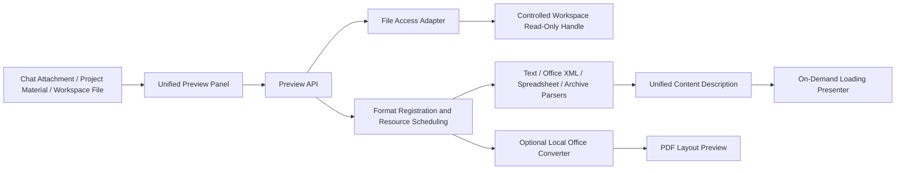

# Local Content Preview Architecture

Design recorded on 2026-10-12 and updated to describe the implemented preview system. It covers gogosling artifacts and project materials while preserving chat, drafts, and P3B file approvals.

## Objectives and Rationale

Open an attachment or artifact to read it alongside the conversation; close the preview to release large objects. A shared preview panel and format-specific toolbars distinguish content reading, layout previews, and formats available only for download.

Maintain the existing architecture of Go daemon + React thin client + independent inference worker. File parsing does not occupy model slots, does not invoke AI, and does not send files to the cloud. Parsers and viewers are selected by format, and converters are started only when needed.

## Modules and Dependencies



1. The **Access Layer** only verifies the Agent, workspace path, file identity, and read limits; it does not interpret files. It uses read-only handles constrained by the root directory, rejecting directories, device files, path traversal, out-of-bounds symlinks, and protected paths. HTTP continues to use existing Bearer, Origin, and Host validations. Read-only previews do not expand tool permissions; file writing independently follows existing approvals.
2. The **Parsing Layer** only receives `context.Context`, name, size, and `io.ReaderAt`, outputting bounded pure data; it must not open other files, connect to the network, start models, or write to databases. Formats use separate modules and may share bounded ZIP/XML helpers.
3. The **Registration and Scheduling Layer** is responsible for extension-based dispatch and format-specific validation, format capabilities, unified budgets, cancellation, and error normalization. Formats are registered explicitly, without reflection, plugin scanning, or background polling. A failure in one format does not trigger blind parsing guesses for other formats.
4. The **Presentation Layer** lazy-loads readers based on the unified `kind`, handling page navigation, worksheet switching, source/preview, downloading, refreshing, and error recovery. It mounts only the current file; React error boundaries isolate rendering failures. Panels reuse existing dimensions and narrow-window tabs.
5. The **Conversion Adapter** is optional, handling legacy Office and precise layout requirements. It runs local LibreOffice with fixed parameters, a timeout, an isolated temporary directory and profile, and at most one conversion at a time. Macros, external link updates, and network access are disabled. If the converter or required isolation is unavailable, explain the limitation and offer download; never upload the file for online conversion.

Dependency direction: `app → server / workbench/preview / workspace`; `server → workbench/preview`; `workbench/preview → model/i18n/standard library`. Parsers do not depend on server, store, app, or React; presenters do not reverse-import pages. No new inference protocols or database migrations.

## Directory Structure

```text
internal/workbench/preview/
  types.go          Content description, budgets, Parser / Source interfaces
  service.go        Registration, identification, scheduling, errors, observation
  text.go           Text, Markdown, HTML, code, CSV/TSV
  package.go        General bounded ZIP/XML reading
  word.go           DOCX text segments, tables, embedded images
  slides.go         PPTX slide content, embedded images
  sheets.go         XLSX worksheets, coordinates, cached values
  opendocument.go   ODT/ODS/ODP content
  archive.go        ZIP/TAR/GZIP listings (no extraction to disk)
  *_test.go         Synthetic real format packages and malicious boundaries
internal/workspace/preview.go      Secure read-only handle
internal/app/adapters_preview.go   Workspace adapter and optional converter wiring
internal/app/preview_converter.go  Optional local Office conversion and sandbox
internal/server/handlers_preview.go  Post-auth HTTP adapter
apps/web/src/api/modules/preview.ts  Sole network entry point
apps/web/src/content/
  types.ts / registry.ts           Content contracts and lazy-loading dispatch
  ContentPreview.tsx               General panel and request lifecycle
  viewers/                        Document/spreadsheet/slide/text/HTML/media/PDF/directory
  preview.css / *.test.tsx         Unified styles and behavioral tests
```

To add a format, implement a parser and register its extensions and parsing function in the format table. Validate the file structure inside the parser and reuse existing document types and viewers. Add a new `kind` and lazy-loaded viewer only for a new interaction pattern; chat pages and file access code should not need changes.

## Interface Conventions

```go
// All are contracts within the preview package, avoiding the expansion of shared storage interfaces.
type Source interface {
    Open(ctx context.Context, agentID, path string) (File, error)
}
type File interface {
    io.ReaderAt
    io.ReadSeeker
    io.Closer
    Stat() (fs.FileInfo, error)
}
type Parser interface {
    Parse(ctx context.Context, input Input) (Document, error)
}
```

`Document` includes `format`, `kind`, `name`, `size`, `mime`, and `version`. Depending on `kind`, it contains text, blocks, slides, sheets, or archive entries, together with machine-readable warnings. Text segments are pure text/emphasis/image/table descriptions, and never contain executable React. Raw HTML is handled only by the dedicated renderer, which sanitizes it before previewing it in an isolated iframe.

Preview API extensions:

- `GET /api/v1/agents/{id}/files?path=...`: Bounded directory list, serving as a discoverable entry point for model-generated files.
- `GET /api/v1/agents/{id}/file-preview?path=...`: Content description; reading and parsing are canceled alongside HTTP cancellation.
- `GET /api/v1/agents/{id}/file-content?path=...`: Controlled raw file stream supporting Range; clients obtain Blobs through authenticated APIs without putting tokens in URLs.
- Optional layout conversion uses a separate request that returns PDF; it does not change raw-file downloads.
- `GET /api/v1/version` advertises `workbench.preview: 1`. Hide preview entry points when an older daemon lacks the capability; preserve existing attachments and artifacts.

## Format Coverage and Boundaries

- Markdown/MDX (without executing JSX), TXT, logs, source code, JSON/XML/YAML/TOML: reading, code highlighting, source view; UTF-8 and BOM-marked UTF-16, other encodings explicitly reported as errors.
- HTML/HTM, SVG: Isolated preview and source view. Scripts, forms, popups, remote resources, and parent-page access are blocked. Static layouts can be displayed; pages that rely on scripts or remote resources are presented with an explicit limitation.
- DOCX/DOTX/DOCM: Paragraphs, headings, tables, embedded images; macros ignored. Complex fields, revisions, and floating layouts are not guaranteed to be pixel-identical with Word.
- PPTX/POTX/PPSX/PPTM: Slides in original order with page navigation, text, images; unsupported masters, animations, and chart objects produce visible warnings; optional PDF conversion to supplement layout.
- XLSX/XLTX/XLSM: Worksheet switching, grid, cached values, formula text; formulas/macros/external links are not executed. CSV/TSV use the same grid reader.
- ODT/ODS/ODP: Reuse document, spreadsheet, and slide content descriptions; subject to the same budget limits.
- PDF: On-demand loading of PDF.js and independent worker, page-by-page rendering, single-page canvas up to 4 million pixels; fonts, CMaps, and decoders ship with the client without CDN access. Scripts, XFA, forms, and embedded attachments are disabled. PNG/JPEG/GIF/BMP/WebP/AVIF/ICO: local images; MP3/WAV/OGG/M4A/FLAC/AAC and MP4/WebM/MOV/M4V/OGV: native controls, no autoplay. Display errors and download options when specific codecs are unsupported.
- DOC/PPT/XLS, RTF: Optional local conversion module; explain missing capabilities when conversion is unavailable. RAR/7z and other non-native archives retain recognition and download without claiming extraction; ZIP/TAR/TGZ/GZ provide bounded listings and metadata without executing or extracting their contents.

These capability tiers make the limits explicit. A recognized extension does not guarantee that a damaged, encrypted, proprietary, or layout-heavy file can be rendered.

## Resource and Security Budgets

- Parse one file at a time with no waiting queue. A busy response can be retried; parsing never uses model execution slots. Ordinary parsing has a 10-second timeout; the separate conversion slot allows one conversion at a time with a 30-second timeout.
- Default limits: text 2 MiB, structured documents 32 MiB, raw file preview 64 MiB, serialized preview response 8 MiB; ZIP up to 2,000 entries, declared total uncompressed size 64 MiB, single entry 8 MiB. Actual decompressed reads are also bounded to protect against forged headers and ZIP bombs.
- Content description limited to 200 pages / 20,000 cells; excess content produces a truncation warning or rejection. Raw-file download remains subject to its own 64 MiB limit. Grids limited to 100 rows per page, slides mount only the current page.
- Closing a preview or switching files cancels requests, revokes Blob URLs, and pauses and unmounts audio/video. There is no background parsing, persistent content cache, or thumbnail library. Long text is paginated at 60,000 characters, long Markdown uses a paginated source view, and documents and tables have a maximum of 100 blocks/rows per page.
- File changes are re-read via refresh; preview is read-only and cannot bypass P3B change summaries, conflict checks, and approvals. If file identity/size/mtime differs before and after reading, a conflict is returned.
- Inputs are treated as untrusted content; archive paths are not written to disk, and XML does not parse external entities; HTML is sanitized via a whitelist and placed into an unprivileged sandbox iframe with CSP blocking network access.
- Temporary conversion directories use mode 0700 and files use 0600; cleanup runs on exit or cancellation. Input, output, concurrency, and time limits bound resource use but do not constitute OS-enforced memory quotas or measured energy savings.

## Errors and Logging

Reuse `model.Code` with `details.reason` values prefixed by `preview_`, including unsupported, too_large, corrupt, encrypted, encoding, busy, timeout, changed, and converter_unavailable. User messages use the zh/en/fr locale packs.

Logs record only request_id, format, stage, code, duration_ms, size_bytes; they do not record original text, credentials, raw parser exceptions, or local absolute paths. Individual failures fall back to a unified error card that supports refresh/download; other panels, chat, and subsequent files remain usable.

## Verification

1. Normal samples for each format with mismatched extensions/signatures; content containing Chinese characters, tables, images, and special characters.
2. Malformed ZIP/XML, decompression limits exceeded, path traversal, out-of-bounds symlinks, non-regular files, UTF-16, corrupted/encrypted files.
3. HTTP auth/Origin, directory isolation, Range, cancellation, concurrency limits, file changes, unified errors, and logs free of body content.
4. Frontend: lazy loading, rapid switching late response handling, close cancellation/Blob release, HTML script and network blocking, table pagination, slide navigation, error boundary recovery.
5. Integration: entering preview from chat attachments, project materials, and workspace; fallback for absent legacy capabilities; preservation of existing drafts and deliverable editing states.
6. Actual browser viewing of MD, HTML, Word, PPTX, XLSX, PDF, images, and audio/video; legacy Office conversion is marked as verified only after real converters and isolated environments pass testing.

## Compatibility Confirmed During Implementation

The browser's built-in PDF iframe failed in the embedded-browser verification environment, so preview uses a separate PDF.js module. Both the main module and parsing worker are lazy-loaded; only the current page is rendered, and tasks and workers are destroyed upon close. Asset building is handled by `apps/web/pdf-assets.ts`, without bundling script execution engines.

Office conversion uses macOS Seatbelt isolation and locates LibreOffice through `GOGOSLING_OFFICE_BIN` or standard installation paths. LibreOffice is not bundled; the conversion adapter is not available on Windows or Linux. The sandbox only allows reading of system runtimes, fonts, converter installation directories, and temporary working directories, with network access prohibited.
