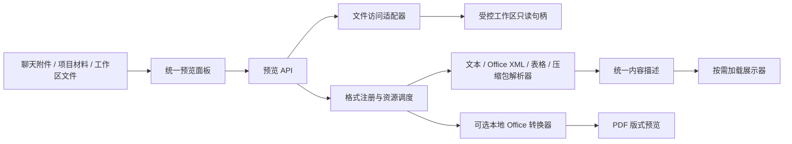

# 本地内容预览架构

2026-10-12。先设计、后实现；适用于 gogosling 成果区及项目材料，不改变既有聊天、草稿和 P3B 文件审批。

## 目标与依据

点击附件或成果即可阅读，关闭即释放大对象。统一文件入口和按格式工具栏支持边读边聊；明确区分内容阅读、版式预览和仅下载。

保持 Go 守护进程 + React 薄客户端 + 独立推理 worker 的现有架构。文件解析不占模型槽、不调用 AI、不把文件送云端。解析器、展示器按格式组合，转换器只在需要时启动。

## 模块及依赖



1. **访问层**只验证 Agent、工作区路径、文件身份与读取上限；不解释文件。使用根目录约束的只读句柄，拒绝目录、设备文件、路径穿越、越界符号链接及受保护路径。HTTP 继续使用既有 Bearer、Origin、Host 校验。只读预览不扩张工具权限；文件写入仍独立走现有审批。
2. **解析层**只接收 `context.Context`、名称、大小及 `io.ReaderAt`，输出有界的纯数据；不得打开其他文件、联网、启动模型或写数据库。每种格式一个模块。
3. **注册与调度层**负责后缀/签名识别、格式能力、统一预算、取消及错误归一。显式注册，不使用反射、插件扫描或后台轮询。一个格式失败不触发其他格式盲猜解析。
4. **展示层**根据统一 `kind` 懒加载阅读器，负责翻页、工作表切换、源码/预览、下载、刷新和错误恢复。只挂载当前文件；React 错误边界隔离渲染失败。面板沿用现有尺寸和窄窗口标签页。
5. **转换适配器**可选，处理旧 Office 和精确版式需求。固定参数调用本地 LibreOffice，单并发、超时、独立临时目录与用户配置，禁止宏、外部链接更新与网络。无合适转换器/隔离能力时明确提示并保留下载；绝不静默上传在线转换。

依赖方向：`app → server / workbench/preview / workspace`；`server → workbench/preview`；`workbench/preview → model/i18n/标准库`。解析器不依赖 server、store、app 或 React；展示器不反向导入页面。没有新增推理协议或数据库迁移。

## 目录

```text
internal/workbench/preview/
  types.go          内容描述、预算、Parser / Source / Converter 接口
  service.go        注册、识别、调度、错误、观测
  text.go           文本、Markdown、HTML、代码、CSV/TSV
  package.go        ZIP/XML 通用有界读取
  word.go           DOCX 文段、表格、内嵌图片
  slides.go         PPTX 幻灯片内容、内嵌图片
  sheets.go         XLSX 工作表、坐标、缓存值
  opendocument.go   ODT/ODS/ODP 内容
  archive.go        ZIP/TAR/GZIP 目录（不解压写盘）
  *_test.go         合成真实格式包与恶意边界
internal/workspace/preview.go      安全只读句柄
internal/app/adapters_preview.go   工作区、可选转换器组合
internal/server/handlers_preview.go  鉴权后 HTTP 适配
apps/web/src/api/modules/preview.ts  唯一网络入口
apps/web/src/content/
  types.ts / registry.ts           内容契约与懒加载分发
  ContentPreview.tsx               通用面板与请求生命周期
  viewers/                        文档/表格/幻灯片/文本/HTML/媒体/PDF/目录
  preview.css / *.test.tsx         统一样式与行为测试
```

新增格式：增加解析模块并在组装表登记扩展名/签名/解析函数；复用现有内容描述和展示器。只有需要全新交互类型时才加新的 `kind` 和懒加载展示器，无需改聊天页面或文件访问层。

## 接口约定

```go
// 均为 preview 包内契约，避免扩张共享仓储接口。
type Source interface {
    Open(ctx context.Context, agentID, path string) (File, error)
}
type File interface {
    io.ReaderAt
    io.ReadSeeker
    io.Closer
    Stat() (fs.FileInfo, error)
}
type Parser interface {
    Parse(ctx context.Context, input Input) (Document, error)
}
```

`Document` 有固定 `format/kind/name/size`；按 kind 返回 text、blocks、slides、sheets、entries，附机器可读 warnings。文段是纯文字/强调/图片/表格描述，不返回可执行 React 或未过滤 HTML。HTML 原始文本只交给专用隔离渲染器。

工作台契约增量（沿用此前授权的 OpenAPI/架构调整）：

- `GET /api/v1/agents/{id}/files?path=...`：有界目录列表，供模型生成文件的可发现入口。
- `GET /api/v1/agents/{id}/file-preview?path=...`：内容描述；读取和解析随 HTTP 取消。
- `GET /api/v1/agents/{id}/file-content?path=...`：受控原文件流，支持 Range；客户端通过带鉴权的 API 获取 Blob，不把 token 放 URL。
- 可选版式转换独立请求，响应为 PDF；与原文件下载分开。
- `/version` 增量能力 `workbench.preview: 1`；旧内核缺席则隐藏新入口，既有附件和成果不受影响。

## 格式覆盖与边界

- Markdown/MDX（不执行 JSX）、TXT、日志、源代码、JSON/XML/YAML/TOML：阅读、代码高亮、源码；UTF-8/UTF-16 BOM，其他编码明确报错。
- HTML/HTM、SVG：隔离预览与源码。禁止脚本、表单、弹窗、远程资源和父页面访问。静态布局可展示；依赖脚本/远程资源的页面不会伪装成完整应用。
- DOCX/DOTX/DOCM：段落、标题、表格、内嵌图片；忽略宏。复杂域、修订、浮动布局不承诺与 Word 像素一致。
- PPTX/POTX/PPSX/PPTM：按原顺序翻页、文本、图片；复杂母版、动画、图表对象用可见提示；可选 PDF 转换补充版式。
- XLSX/XLTX/XLSM：工作表切换、网格、缓存值、公式文本；不执行公式/宏/外链。CSV/TSV 使用同一网格阅读器。
- ODT/ODS/ODP：复用文档、表格、幻灯片内容描述；受相同预算限制。
- PDF：按需加载 PDF.js 和独立 worker，逐页渲染，单页画布最多400万像素；字体、CMap、解码器随客户端提供，不访问CDN，不启用脚本、XFA、表单或嵌入附件。PNG/JPEG/GIF/BMP/WebP/AVIF/ICO：本地图片；MP3/WAV/OGG/M4A/FLAC/AAC 与 MP4/WebM/MOV/M4V/OGV：原生控件，不自动播放。具体编码器不受支持时显示错误与下载。
- DOC/PPT/XLS、RTF：可选本地转换模块；转换不可用时说明缺失能力。RAR/7z 等非原生压缩包保留识别与下载，不声称已解压；ZIP/TAR/TGZ/GZ 提供安全目录/元数据，不执行或写出内容。

这些是实际能力分级，不用“支持所有格式”掩盖损坏、加密、旧版二进制、专有编码和复杂版式差异。

## 资源与安全预算

- 内容解析单并发、无无限队列；占用时可重试，不挤占模型执行槽。普通文件解析10秒上限；转换单并发30秒。
- 初始默认：文本2 MiB、结构化文档32 MiB、原文件预览64 MiB；ZIP最多2,000项、声明展开总量64 MiB、单项8 MiB。实际读取也限流，防伪造头部与 ZIP bomb。
- 内容描述限制200页/20,000单元格；超限带明确截断提示或拒绝，原文件保留下载。网格每页100行，幻灯片只挂当前页。
- 页面关闭/切换取消请求、回收 Blob URL、显式暂停并卸载音视频，不后台预解析、不持久化正文缓存、不写缩略图库。长文本按60,000字符分页，长 Markdown 使用分页源码，文档与表格每页最多100个块/行。
- 文件变化通过刷新重新读取；预览只读，不能绕过 P3B 变更摘要、冲突检查和审批。读取前后文件身份/大小/时间不一致则返回冲突。
- 输入按不可信内容处理；压缩包路径不落盘，XML不解析外部实体；HTML由白名单清理后放入无权限 sandbox iframe，CSP拒绝网络。
- 临时转换材料目录0700、文件0600；退出/取消清理。并发/输入/输出/时间限制是资源约束，不虚称操作系统强制内存额度或节能百分比。

## 错误与日志

复用 `model.Code`，`details.reason` 采用 `preview_*`：unsupported、too_large、corrupt、encrypted、encoding、busy、timeout、changed、converter_unavailable。用户消息走 zh/en i18n。

日志只记录 request_id、format、stage、code、duration_ms、size_bytes；不记录原文、凭据、解析器原始异常或本地绝对路径。单次失败退回统一错误卡，可刷新/下载；其他面板、聊天和后续文件仍可用。

## 验证

1. 各格式正常样本与扩展名/签名不符；内容含中文、表格、图片、特殊字符。
2. 畸形ZIP/XML、解压超限、路径穿越、越界符号链接、非普通文件、UTF-16、损坏/加密文件。
3. HTTP鉴权/Origin、目录隔离、Range、取消、并发上限、文件变化、统一错误、日志不含正文。
4. 前端：懒加载、快速切换迟到响应、关闭取消/Blob释放、HTML脚本和网络阻断、表格分页、幻灯片翻页、错误边界恢复。
5. 集成：从聊天附件、项目材料和工作区进入预览；旧 capability 缺席回退；保留已有草稿及成果编辑状态。
6. 浏览器实际查看 MD、HTML、Word、PPTX、XLSX、PDF、图片和音视频；旧 Office 转换只在真实转换器与隔离环境测试通过后记为已验证。

## 实现中确认的兼容性

浏览器内置 PDF iframe 在当前内嵌浏览器中不显示，因此改用独立 PDF.js 模块。主模块和解析 worker 均延迟加载；只绘制当前页，关闭销毁任务与 worker。资源构建由 `apps/web/pdf-assets.ts` 负责，不打包脚本执行引擎。

Office 转换当前实现 macOS Seatbelt 适配，通过 `GOGOSLING_OFFICE_BIN` 或标准安装路径发现；未捆绑 LibreOffice，Windows/Linux 不声称已具备版式转换。沙箱只允许系统运行库、字体、转换器安装目录和临时工作目录的读取，网络禁止。
