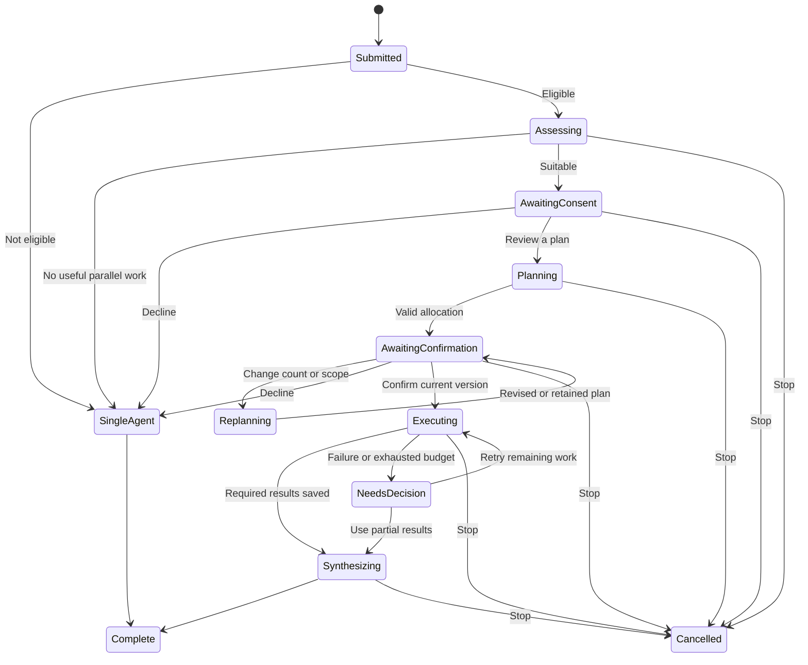

# Multi-agent collaboration

Status: implementation proposal, 2026-10-13. This document describes planned behavior, not a shipped capability. gogosling is developed by Gogosling.ca, a Canadian company.

## 1. Decision and scope

Add an optional collaboration flow to the existing conversation and results panel. Keep one visible task and one lead Agent. The lead Agent assesses the request, proposes a bounded set of subtasks, and combines their results. The user must approve both the use of collaboration and the final allocation before any subagent starts.

The first release should support two to four planned subagents, defaulting to two. A count of one means continuing with the existing single-Agent flow. Planned subagents are not the same as simultaneous model requests: the global resource limit remains authoritative. Collaboration may improve a task with independent parts; it does not guarantee a faster result or lower token use.

Start with read-only analysis, drafting, and review subtasks over explicitly selected context. Subagents return proposed content, findings, and references; they do not write files, run commands, browse, call extensions, or delegate again. The lead Agent can continue through existing tools after synthesis, subject to the existing permission checks. Saved results use the existing artifact workflow. Applying or undoing file changes remains a separate P3B operation with its own preview and approval.

This scope supports a useful complete flow without immediately introducing concurrent writers, nested delegation, or new permissions. Tool-enabled subagents and isolated writable worktrees require a later design and explicit capability version.

## 2. Existing constraints verified in the repository

| Existing behavior | Source | Consequence |
| --- | --- | --- |
| One active Run per session | [Session service](../../internal/session/service.go), [run reservation](../../internal/session/run.go) | A child cannot call ordinary `Send` against its parent's session. |
| Two execution slots and a queue of 32 by default; configurable parallelism of 1–8 | [Admission controller](../../internal/session/admission.go) | Planning, children, synthesis, ordinary runs, and prompt enhancement must share one admission budget. |
| Runs using the same resolved workspace are dispatched serially | [Admission controller](../../internal/session/admission.go) | Never invent a different workspace identifier merely to bypass serialization. |
| An execution awaiting tool approval still occupies a slot | [Resource state](../../internal/session/admission.go) | A waiting parent must not retain a model execution while depending on a queued child. |
| A business Run has immutable terminal states | [Run types](../../internal/model/run.go), [transitions](../../internal/session/state.go) | Restart recovery must not revive a failed Run or fabricate child Runs. |
| Worker `run.start` rejects duplicate run IDs | [Worker protocol](../../api/worker-rpc/protocol.md) | Distinct child execution identities need an explicit protocol extension. |
| Tool approvals reference a real Run or Operation | [Approval types](../../internal/model/approval.go) | Collaboration consent is not an `ApprovalRequest` and grants no tool access. |
| Drafts use optimistic versions; artifact revisions are immutable | [Architecture](../architecture.md#54-workbench-persistent-state) | Opening a plan must preserve unsaved drafts and existing editor state. |
| Results panel is 420–640 px, with tabs in narrow windows | [Chat workspace](../../apps/web/src/pages/chat/ChatPage.tsx) | Reuse this panel rather than adding another permanent column. |

The [dependency rules and security invariants](../architecture.md) remain authoritative. The contract extensions below require architecture-owner review before implementation. This proposal does not edit shared types, current API contracts, or runtime behavior.

## 3. Complete user flow

### 3.1 Sending and assessment

1. The user writes a request, selects materials, and sends it as usual. Commit the input message and a real root Run once. Preserve normal draft recovery if submission fails.
2. For clients that support this flow, a local eligibility check excludes trivial requests, explicit single-Agent requests, unsupported models, background/channel triggers, and configurations without a safe planning budget. This check uses bounded metadata; it does not scan the whole workspace or load every attachment. Excluded requests enter the existing flow with no extra assessment call.
3. For eligible requests, the lead Agent makes one bounded assessment using the selected model and a compact, validated context packet. All tools are disabled. It returns a structured decision, a short user-facing reason, candidate independent work areas, and any blocking dependency. Do not request or store a chain-of-thought transcript.
4. If the task has no useful independent work, continue single-Agent execution. If it does, show one concise consent card in the conversation. Announce the card accessibly without interrupting typing elsewhere.

Suggested copy, to be localized through the existing locale packs:

> This task has parts that can be handled separately. Collaboration uses more tokens and may help complete complex work more efficiently.

Actions: **Review a plan** and **Continue with one Agent**. Include a short, task-specific reason. A secondary disclosure explains that the initial assessment already used a small amount of tokens; it is included in the task's usage.

Do not silently enable the mode for future tasks. A preference can disable suggestions. Any future persistent opt-in must remain distinct from confirmation of a particular execution plan.

### 3.2 First decision

- **Review a plan:** record consent, then ask the lead Agent to produce the allocation. This is planning only; no child is created for execution yet.
- **Continue with one Agent:** record the decision and continue the original request in the same root Run. Do not append a second user message or replace the user's prompt with the planner's summary.
- **Dismiss:** collapse the prompt into a pending decision card. Dismissal, Escape, closing the panel, switching conversations, and closing a desktop window are neither approval nor refusal. No child starts while a decision is pending.
- **Stop:** cancel the task, including active planning and queued execution. Do not interpret Stop as a request to continue with one Agent.

Only eligible interactive clients initiate this flow. CLI, scheduled tasks, and messaging channels keep the single-Agent behavior until they explicitly support the decision protocol.

### 3.3 Allocation preview

After the first approval, open **Collaboration** in the existing right-hand results panel. On narrow windows, select the corresponding workspace tab. Show:

- A one-sentence objective and a compact flow: **Lead → subtasks → review and combine**.
- **Subagents: 2**, with a count control limited to the supported range.
- One card per subagent: role, concrete task, selected input references, expected output, dependencies, and an advisory token range.
- Total task estimate, tokens already spent planning, the remaining budget, and **up to N active at once** from current capacity. Describe serialization where applicable.
- A persistent distinction between **estimated** and **reported** token use. Unknown usage is not displayed as zero.
- Actions: **Start collaboration**, **Adjust plan**, and **Continue with one Agent**.

Avoid a large paragraph of instructions, decorative progress percentages, separate chat windows for every child, or a repeated warning on every card. Expand assumptions and detailed context only on request.

The count is the number of planned child tasks. The main Agent is not included. The plan may show four children even when the user's global limit permits only one or two active executions.

### 3.4 Adjusting the count or scope

Changing the count updates a local proposed value, not the accepted plan. The user presses **Update allocation** with optional concise feedback. The lead Agent must redistribute the responsibilities, recompute dependencies and estimates, and return a new immutable plan version. Do not merely add empty cards or divide the old estimate by the new count.

While replanning, keep the previous plan visible but disable its Start action. Offer cancellation of the pending revision. A cancelled or failed revision leaves the previous valid plan available, clearly marked as unchanged. Planning calls consume the same task budget, including revisions the user rejects.

After a successful update, mark changed responsibilities and refresh the total estimate. Require an explicit **Start collaboration** against that version. If the requested count would duplicate work or exceed limits, explain why and keep the last valid plan; do not silently substitute another count. Selecting one Agent takes the explicit single-Agent branch.

### 3.5 Execution and completion

On confirmation, the daemon validates ownership, plan version and digest, context snapshot, permissions, model configuration, resource limits, and remaining budget. It atomically records the accepted plan before making any child eligible for dispatch.

Cards show actual states: **Queued**, **Working**, **Waiting for a dependency**, **Complete**, **Failed**, or **Cancelled**. A compact parent status shows assessment, allocation, child work, and synthesis. The lead Agent aggregates completed results only after their durable result records exist. It identifies missing work explicitly if the user chooses to finish with partial results.

Keep one final assistant response in the original conversation. Link the result to the plan and expandable subtask evidence. Save generated documents through the existing artifact/version APIs; a child response is not represented as an invented public chat message just to satisfy artifact ownership.

After execution begins, changing the allocation requires stopping unfinished work and creating a new plan for the remainder. Preserve completed outputs and disclose any extra planning cost. Do not hot-change the meaning of an already approved plan.



The diagram shows the main path. Every nonterminal state also supports cancellation; transient service errors retain a recoverable record rather than implying acceptance.

## 4. Module boundaries

| Area | Proposed files | Responsibility |
| --- | --- | --- |
| Shared contracts | `internal/model/collaboration.go`, `internal/model/collaboration_repository.go` | Collaboration, PlanRevision, Subtask, ExecutionAttempt, usage completeness, and repository interfaces. |
| Orchestration | `internal/session/collaboration.go`, `collaboration_plan.go`, `collaboration_recovery.go` | Eligibility, consent, plan validation, transitions, dispatch, synthesis, cancellation, and recovery; no database implementation imports. |
| Resource admission | Extend `internal/session/admission.go` | Admit individual executable units through the existing shared limit; separate logical task ownership from execution slots. |
| Persistence | `internal/store/collaboration.go`, a new migration | Transactions, optimistic updates, plan revisions, completed output references, idempotency records, and execution journals. |
| Runtime | Extend `internal/engine` and worker `methods.py`, `runtime/engine.py`, `runtime/loop.py` | Negotiated execution identities, typed events, bounded contexts, cancellation, and provider usage. |
| HTTP/SSE | `internal/server/collaboration.go`, `api/openapi/openapi.yaml` | Authenticated endpoints, input validation, capability advertisement, snapshots, and additive events. |
| Composition | `internal/app` | Inject repositories, permission/tool adapters, worker capabilities, and resource admission. |
| Web API/state | `apps/web/src/api/collaboration.ts`, `apps/web/src/state/collaboration.ts` | Typed calls and session-scoped server state; no direct fetches from components. |
| UI | `apps/web/src/pages/chat/collaboration/` | Lazy-loaded consent card, plan panel, count editor, execution cards, budget details, and recovery actions. |
| Copy | `internal/i18n`, `apps/web/src/locales/{zh,en,fr}.json` | Localized statuses, errors, actions, and accessible labels. |

Use interfaces injected into `session` by the composition root. Do not introduce a `workbench → session → workbench` import cycle. Content snapshots can use an injected controlled material reader; the Python worker never opens the daemon's data directory or reads arbitrary workspace files itself.

Selecting a material does not grant a new file permission. Snapshot creation must reuse the existing ownership, path, and read-permission checks, including any required approval. Pending read approval holds no planning inference slot. If a selected source cannot be read safely, preserve the request and ask the user to resolve it or continue with available context; never broaden access to make a plan possible.

No new frontend state library, database service, worker subprocess per child, or external scheduler is required.

## 5. Data and service contracts to add

The following names are proposed contracts, not available interfaces.

### 5.1 Durable records

- **Collaboration:** `id`, `session_id`, `root_run_id`, `input_message_id`, principal, `state`, `version`, `current_plan_id`, `accepted_plan_id`, original context manifest digest, budget, usage completeness, timestamps, and optional previous root Run reference for recovery.
- **PlanRevision:** immutable `id`, `collaboration_id`, `revision`, objective, requested child count, validated DAG, selected context references/digests, model configuration digest, estimate with assumptions, and approval digest. Never store credentials or hidden prompt text.
- **Subtask:** `id`, collaboration and accepted plan IDs, role, instruction, dependency IDs, allowed context references, output specification, input/output limits, state, and durable result reference. A subtask is not a business Run or a new sidebar session.
- **ExecutionAttempt:** `id`, real `root_run_id`, optional `subtask_id`, phase (`assessment`, `plan`, `child`, `synthesis`, or `single`), attempt number, lease, state, provider/model identity without credentials, per-call usage records, completeness, and start/end times.
- **Decision/idempotency record:** authenticated principal, action key, canonical request digest, resulting record IDs and version. Same key plus same request returns the original outcome; the same key with different content returns a conflict.

Persist small context manifests once and deduplicate immutable shared content by digest. Queue entries hold IDs and limits, not expanded histories, provider keys, copied file trees, or open HTTP clients. Enforce byte limits on plans, outputs, and retained attempts; exact retention policy should be configurable and must preserve referenced artifacts and unresolved recovery evidence.

Keep current `RunStatus` values. The root Run represents the user's actual task; a separate collaboration state describes decisions and coordination. It may be `running` while awaiting plan consent, but holds no execution slot then. Do not misuse `awaiting_approval` for plan consent: that status remains associated with existing tool approvals. Expose the collaboration state to capable clients so the task does not appear to be continuously computing.

Suggested collaboration states: `assessing`, `awaiting_consent`, `planning`, `awaiting_confirmation`, `executing`, `synthesizing`, `needs_decision`, `recovery_required`, `completed`, `cancelled`, and `single_agent`. A planning attempt may fail while the collaboration remains recoverable; failures and reasons belong to the attempt rather than overwriting the last valid plan.

### 5.2 Domain service shape

```go
// Proposed signatures; all referenced types require a reviewed shared contract.
Prepare(ctx context.Context, req PrepareCollaborationRequest) (*Collaboration, error)
Get(ctx context.Context, id string) (*CollaborationSnapshot, error)
Decide(ctx context.Context, id string, req CollaborationDecision) (*CollaborationSnapshot, error)
Replan(ctx context.Context, id string, req ReplanRequest) (*CollaborationSnapshot, error)
Confirm(ctx context.Context, id string, req ConfirmPlanRequest) (*CollaborationSnapshot, error)
Cancel(ctx context.Context, id string, req CancelCollaborationRequest) error
Resume(ctx context.Context, id string, req ResumeCollaborationRequest) (*CollaborationSnapshot, error)
```

The session service owns root Run creation and one-active-Run-per-session reservation. `Prepare` is invoked by that service as part of an eligible Send, not an alternative endpoint that appends the same input twice. Collaboration persistence must participate in the same transaction as the root Run and input when the flow is selected. If a separate repository interface is used, its transaction implementation must cover those shared records; sequential best-effort inserts are insufficient.

Every mutation carries `expected_version` and an idempotency key. Confirm also binds `plan_id` and `plan_digest`. Two windows racing to confirm, replan, decline, or stop must produce one accepted transition. A stale request returns HTTP 409 with the current safe snapshot. Queue saturation and permission/model changes must not leave a partially approved child set running.

### 5.3 HTTP and events

Add optional capability `collaboration.plan: 1` to the existing version response only when daemon storage, engine, worker, and budget enforcement support the full flow. Advertise separate limits such as maximum child count and supported read-only execution profile.

Extend `POST /api/v1/sessions/{id}/messages` with optional `collaboration: { mode: "ask" | "off" }` and request idempotency. Omission preserves single-Agent behavior for older clients. An initial response can include an optional `collaboration_id` alongside the existing Run. Never make old clients accept a new required Run status.

Proposed additional routes:

| Method and path | Request purpose |
| --- | --- |
| `GET /api/v1/collaborations/{id}` | Read the durable snapshot and current plan, with paginated output references. |
| `POST /api/v1/collaborations/{id}/decision` | Consent to planning or decline to single-Agent execution. |
| `POST /api/v1/collaborations/{id}/replan` | Request a new child count and optional scope feedback. |
| `POST /api/v1/collaborations/{id}/confirm` | Confirm one exact validated plan and budget. |
| `POST /api/v1/collaborations/{id}/cancel` | Stop pending decisions, planning, children, or synthesis. |
| `POST /api/v1/collaborations/{id}/resume` | Explicitly resume verified unfinished work after interruption. |
| `POST /api/v1/collaborations/{id}/retry` | Retry selected failed, read-only subtasks within an accepted remaining budget. |
| `POST /api/v1/collaborations/{id}/finish-partial` | Explicitly request synthesis with the listed missing subtasks. |

All routes retain current Bearer, Host, Origin, principal ownership, and session access checks. Reusing an ID from another principal or session must fail without exposing content.

Add `collaboration.updated`, `collaboration.plan_ready`, `collaboration.subtask_updated`, and `collaboration.usage_updated` events to the existing event bus. Include session, root Run, collaboration, plan version, execution attempt, and sequence identities as appropriate. Publish minimal state deltas, not the whole plan or every child's full output on each token. Fetch the authoritative snapshot on reconnect gaps; stale-plan events cannot replace newer revisions.

### 5.4 Worker protocol and tool callbacks

Do not reuse `run.start` with invented child Run IDs. Add an optional negotiated worker capability, for example `execution.v1`, with `execution.start`, `execution.cancel`, and `execution.event`. Existing `run.*` semantics remain unchanged for ordinary tasks.

An execution request carries a unique persisted `execution_id`, the real `root_run_id`, session and optional subtask IDs, phase, a bounded context packet, model credentials at dispatch only, tool allowlist, and input/output/step/deadline limits. The daemon validates all parent-child relationships; a model cannot supply identities that authorize access.

The engine gains a separate optional `ExecutionRuntime` interface rather than pretending that each execution has a `model.Run` row. Execution events use their own envelope and are translated by the coordinator into subtask updates and, when appropriate, the final root Run events. Only synthesis or the single-Agent continuation publishes the final conversation message. Each attempt has exactly one terminal event; duplicate and late events are ignored after their durable terminal record.

If the lead's final execution uses tools, its reverse callback includes `execution_id`; the daemon resolves this to the real root Run and immutable allowed scope before calling the existing executor. Approval ownership stays with that real Run. First-release assessment, planning, and child phases expose no tools, and any forged callback from those phases is rejected in the daemon. Prompt instructions alone are not a security boundary.

## 6. Validating a plan

Validate structured output against a strict schema before it becomes reviewable:

1. The requested count matches two to four distinct, nonempty subtask records. Each record has bounded text and a concrete output specification.
2. Dependencies reference valid IDs and form a DAG. Disallow self-dependencies, cycles, unknown tasks, nested delegation, and the parent depending on its own completion.
3. Context references are a subset of the original user-selected and daemon-authorized material snapshot. Treat file and child-output text as untrusted data, never as authority to change instructions or permissions.
4. Model choices and execution profiles come from the daemon's allowlist. The planner cannot grant network, command, file-write, extension, or secret access.
5. The count, context sizes, output sizes, step limits, deadlines, and total allocation fit the current task budget and global configuration.
6. Aggregation instructions describe how to resolve inconsistent outputs and report missing evidence; they must not claim verification that no child performed.

Make at most one bounded schema-repair attempt within the planning-call allowance. If output remains invalid, retain the original request and offer single-Agent continuation or a user-initiated retry. Never dispatch a partially parsed plan.

## 7. Token estimates and enforceable limits

### 7.1 Estimate convention

Display an advisory **input + output token range**, not a price, invoice, or speed promise. Count the assessment, all plan/replan calls, repeated context supplied to every child, child work, and synthesis. The total is not just the sum of visible child output limits.

For each planned model call `c`, record input estimate `I(c)`, expected output range `[L(c), U(c)]`, and the tokenizer/model assumptions. The task range is:

```text
low  = planning_spend + sum(input_estimate(c) + expected_output_low(c))
high = planning_spend + sum(input_upper_estimate(c) + output_cap(c))
```

Here the sum covers all remaining planned calls, including synthesis and bounded retries if reserved. `planning_spend` uses reported usage where available; otherwise it is a conservative reserved estimate marked as such. Replanning adds to spent usage rather than replacing it. Repeated input and dependency outputs are counted at every call in which they are sent. Cache read/write usage is shown separately when reported; do not subtract an invented cache discount.

The low end is an assumption for planning, not a minimum charge. The high end is a configured estimate envelope, not a provider billing guarantee. Show the assumptions in an expandable section and replace estimates with reported usage as calls finish, without erasing incomplete-usage indicators.

### 7.2 Budget control

Introduce a task-wide budget ledger with atomic reservations before dispatch. Each model call reserves its bounded input estimate plus output cap; when reliable usage arrives, reconcile once per call. Do not sum incremental `usage` events and the cumulative terminal usage twice. If the provider supplies no usage, retain the conservative reservation and mark actual usage unavailable.

Initial proposal limits: one assessment call; one initial allocation call; at most two user-requested replans; at most one schema repair within the remaining planning allowance. Use one globally active planning inference, a 30-second deadline per call, a 1,024-token assessment output cap, and a 2,048-token allocation output cap. These are proposed control limits, not measured performance. Context caps and child/synthesis limits must also fit the selected model and the user-visible task budget. A failed or cancelled call still counts against planning attempts and any known/reserved usage.

Estimates must be based on the actual serialized context, including system instructions and result envelopes, with a model-compatible tokenizer where available. The current provider model stores do not supply verified context-window metadata; add explicit model capability metadata before relying on it. A routing alias with an unknown downstream model must use a documented minimum supported context limit, or decline collaboration. Do not silently assume that every model accepts the same context size.

For unknown tokenizers, byte/character heuristics may support a clearly marked rough estimate but cannot establish a hard billing bound. If safe context and output limits cannot be established, keep the request in the existing single-Agent flow. Reserve room for synthesis before allocating child work. Do not start another call when its reservation exceeds the remaining budget; ask whether to finish with partial results or approve a revised remaining budget. Already-started provider billing cannot be rolled back by cancelling locally.

## 8. Scheduling without deadlocks

Refactor admission around **executable units**, while retaining the existing session lock for the logical root task. A coordinator is durable state, not a continuously running worker request.

- Assessment and allocation acquire one slot and release it after their terminal event. Waiting for either user decision holds no model task, provider connection, workspace execution lease, or inference slot.
- After plan confirmation, create only durable child descriptors. Admit ready children into the bounded queue just in time; do not enqueue all dependency-blocked work or load its full context.
- While children execute, the lead waits as a coordinator without a slot. It acquires a slot for synthesis only after dependencies have completed. With a global limit of one, children and synthesis therefore run sequentially without a parent-child deadlock.
- Preserve foreground priority and the existing 30-second aging policy. A collaboration must not monopolize the queue: use round-robin selection across root tasks for equally eligible child units. Queue saturation leaves undispatched children as `pending`, bounded by the plan's four-child limit.
- Preserve current approval semantics: an executing tool call awaiting approval continues to hold its slot. First-release child phases have no tools, and the parent can enter a tool-enabled phase only after required children finish. Approval resolution is a control operation that must not need an inference slot. Never start children while a parent is suspended inside a tool approval.
- Keep same-resolved-workspace execution serial. The first release may parallelize inference over daemon-created immutable, bounded context packets with **no live workspace or tool access**; such an execution is explicitly classified as snapshot-only and does not claim a workspace lease. Any execution needing live workspace access uses the original workspace identity and serialization. No duplicate workspace copies or renamed group keys bypass this rule.
- Ordinary runs, prompt enhancement, planning, and children all count toward the same maximum. Lowering the cap allows already active work to finish and limits subsequent dispatch; it does not spawn replacement work or kill tasks automatically.

The current queue capacity calculation derives queued work from active Runs; it cannot be reused unchanged once a root Run can wait without a slot. Maintain explicit counts for active executable units, admitted queue entries, pending root tasks, and suspended coordinators. Cap pending/suspended collaborations separately, initially at 32 globally and one per session, so a series of unanswered suggestions cannot grow without bound. Expose these categories accurately in Resources; preserve existing field meanings for old clients and add optional collaboration counters.

## 9. Cancellation, failure, and restart recovery

Cancellation first persists the intent and invalidates unstarted leases, then propagates to assessment, planning, each active child, and synthesis. Queued work is removed without starting the provider. Abort pending tool callbacks, close provider streams, and release slots after execution termination or forced cleanup. Use the existing five-second cancellation grace as the initial cleanup deadline; measure the actual release latency in tests. Ignore late result events from cancelled or superseded attempts, while retaining known usage and previously completed outputs.

A failed child should not erase completed siblings. Mark dependent tasks blocked, retain independent results, and offer a bounded retry, partial synthesis, or Stop. A retry is a new execution attempt under the accepted plan, not a duplicate result. Any materially changed scope or increased budget requires a new plan confirmation.

Persist state transitions, plan confirmation, execution intent, and completed output references transactionally. Do not hold a database transaction while awaiting a model or user. A lease identifies an attempt; it is not proof that a side effect did or did not occur.

On daemon restart, preserve the current rule that interrupted real Runs become terminal failures. Retain the collaboration in `recovery_required`, with verified completed subtask outputs and a list of interrupted or unknown attempts. An explicit Resume creates a **new real root Run** linked to the previous Run and original input, in the same session, without duplicating the user's message. Completed results are reused only if their accepted plan, model/context assumptions, and input digests still match. Changed inputs require a new preview and confirmation.

Never automatically replay an interrupted side-effecting lead execution. Reconcile its tool audit and any P3B operation journals; an uncertain result requires user review. P3B recovery remains owned by its existing operation workflow, and unresolved operations block further writes. Resuming child analysis does not imply permission to replay a completed file write or command.

If a worker lacks the negotiated execution capability, do not advertise collaboration. If capability is lost after consent but before confirmation, retain the plan for inspection and offer explicit single-Agent continuation. If loss happens during execution, preserve durable outputs and enter recovery; do not silently repeat the task using another backend.

## 10. Frontend state and compatibility

Use React Query keys scoped by session and collaboration ID. The server snapshot is the source of truth; local state holds only the proposed count, optional feedback, expanded cards, and selected panel view. Every callback must verify session, collaboration, and plan version before applying its result.

Lazy-load the collaboration panel after eligibility is known or the user opens a saved plan. Subscribe only to the current session's detail stream; use compact summary events for background tasks. Coalesce text display updates but apply approvals, cancellation, and terminal states immediately. Release inactive detail caches after durable persistence and when no page subscribes.

Add a panel selector for **Results / Collaboration**. Opening Collaboration hides the existing artifact editor without unmounting its unsaved state, following the current preview behavior. Closing the panel is not a task cancellation. Navigating away preserves the current draft and the server-side decision; returning restores the same pending plan. Keyboard navigation, focus return, screen-reader announcements, reduced motion, and narrow-window tabs remain consistent with the current app.

Source builds and packaged builds use the same collaboration contracts. Optional release diagnostics are separate and do not gate this feature. Existing sessions, artifacts, drafts, shortcuts, and single-Agent Send calls remain usable. Old daemons omit the capability and newer UIs keep the existing flow. Old clients may read the root Run and final response but must not submit guessed plan decisions. They can still use the existing Run cancellation operation, which must cancel the whole collaboration.

The database change is additive and must use the existing verified pre-migration backup mechanism. Choose the next available migration number at implementation time. Do not promise that older binaries can open a newer schema; use the documented matching-backup recovery process for downgrades.

## 11. Verification and acceptance

| Scenario | Required result |
| --- | --- |
| Simple input or explicit single-Agent request | Existing path; no extra assessment call and no collaboration UI. |
| Suitable task | One consent prompt; no children before final plan confirmation. |
| User declines at either decision | Original input continues once through single-Agent execution. |
| Change 2 children to 3 | New responsibilities, DAG, and estimate; previous version cannot start. |
| Two windows confirm/replan/decline concurrently | One CAS transition; other window receives current state; no duplicate execution. |
| Repeated Send/Confirm after network timeout | Idempotency returns the same message, Run, and accepted plan. |
| Cyclic, malformed, over-budget, or privilege-escalating plan | Reject before dispatch; retain a recoverable task and valid previous plan. |
| Global cap 1; another run awaits approval | No parent-held-slot deadlock; approval can resolve without an inference slot; admitted work never exceeds the cap. |
| Global cap lowered while children run | Active work may finish; no new dispatch above the new limit. |
| Same workspace, symlink aliases, or mixed snapshot/live work | Live workspace tasks remain serialized by resolved identity; snapshot-only tasks cannot call tools or read changing files. |
| Queue saturation and several collaborations | Bounded memory and queue length; ordinary/background work is not starved. |
| Cancellation during assessment, queueing, child work, or synthesis | No later stage starts; streams/callbacks end; all slots released within the cleanup bound. |
| Missing, duplicate, cumulative, or late usage | No double counting; missing usage remains unknown; conservative reservations remain visible. |
| Child failure or provider timeout | Completed siblings survive; dependent tasks stop; retry/partial completion is explicit. |
| Restart around confirmation, dispatch, or output persistence | Durable state reconciles; no automatic side-effect replay; completed results stay reusable where valid. |
| Root cancellation through an old client | Cancels every execution attempt and pending decision. |
| Old daemon/worker or omitted request field | Existing single-Agent behavior; no unsupported methods are called. |
| Unsaved artifact, session switch, plan event arriving late | Draft and editor content survive; wrong-session events do not replace the visible plan. |
| Plan accepted, then P3B apply or undo requested | Separate preview and permission path; task consent never counts as file approval. |

Implement unit tests for plan validation, state transitions, CAS/idempotency, reservations, usage completeness, and dependency scheduling. Add store migration/restart tests using temporary databases; worker tests use local fake providers and verify stream cancellation. Add React interaction tests for both decisions, count revisions, keyboard/focus behavior, stale responses, panel preservation, and the capability fallback.

End-to-end tests should cover the full single-Agent and collaboration paths with the real worker and a fake model service, including cap-one scheduling, a stalled approval, disconnect/reconnect, cancellation, and daemon restart. Verify Linux, macOS, and Windows in CI. Provider billing cancellation is outside the application's control and must not be asserted from a closed local socket.

Measure idle/active RSS, number of live inference calls, queue depth, cancellation-to-slot-release latency, context bytes, and task completion time against the same single-Agent workload. Report measured results and workloads; do not claim energy, memory, or speed percentages before collecting evidence.

## 12. Delivery sequence

1. Review shared models, transaction boundaries, optional HTTP/worker capabilities, and resource counters. Update authoritative contracts before implementation.
2. Implement persistence, schema validation, consent/replan/confirm state transitions, and fake-runtime tests. Keep the capability disabled until the full path is ready.
3. Add executable-unit admission and the negotiated worker protocol; validate cap-one behavior, usage accounting, and cancellation before enabling children.
4. Add the localized lazy-loaded UI and preserve existing results/drafts. Use explicit mock fixtures for design review; do not present simulated work as real execution.
5. Complete recovery, compatibility, and cross-platform end-to-end tests. Publish the capability only when these checks pass; retain the single-Agent fallback.

No runtime or shared-contract change is delivered by this document. Implementation remains pending the reviewed contract work and the acceptance checks above.
