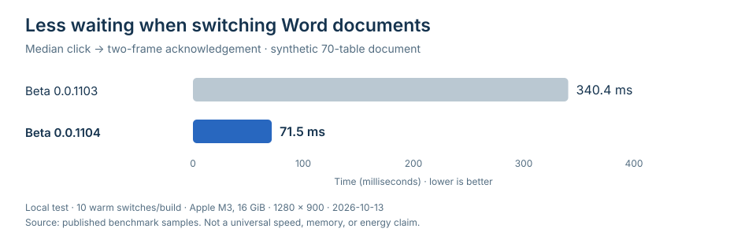

# Preview performance and Beta 0.0.1104

Date: 2026-10-13. Machine: Apple M3, eight CPU cores, 16 GiB memory, macOS 27. All document inputs were generated locally. No customer document, account, model credential, or real inference request was used. The public website checks were read-only.

## What was measured

Three measurements cover different parts of the application. They must not be added together or presented as one whole-app benchmark.

1. **File API:** a real, isolated Go daemon reads six synthetic files, 25 times per file. A separate 20-request cancellation series measures how soon the next preview can acquire the parser. RSS is sampled every 20 ms, with a three-second idle observation. The reports use nearest-rank p95 and retain all samples.
2. **Visible document switching:** the built React client uses that real authenticated daemon through a local test proxy. At a fixed 1280 × 900 viewport, browser automation performs six first opens and ten warm switches per file. A test-only observer starts at the actual click and ends two animation frames after the current content mounts. This is a presentation acknowledgement, not input-to-photon timing. Long tasks are recorded independently and matched to each sample's time interval.
3. **Native webpage host:** a real Electron 44.7.0 host performs 30 switches among four synthetic URLs, with 1,600 paragraphs and an 8 MiB retained array per page. It records operation return, navigation load, frame acknowledgement, process memory, views, sessions, workers, proxy connections, and cleanup after 0, 5, and 15 seconds. Separate public-page samples include network effects.

The first exploratory UI run used a viewport that changed during testing. It identified the dense-table stall but is not used for the fixed-viewport comparison. An exploratory full-app memory trace was also excluded from comparative claims because the test window was changed during collection and a webpage entry had not actually loaded.

## Changes supported by the measurements

- Word XML parsing now checks cancellation, and empty XML attribute maps are no longer allocated for every node. Plain paragraphs omit duplicate run text while preserving the existing optional-field contract.
- Word pages share a 1,000-cell table budget. Markdown uses structural and character budgets, repeats table headers, preserves list numbering, and renders only the current page. A complex indivisible atom that cannot be paginated safely is shown as bounded source text instead of being truncated.
- Format modules still load on demand. The file pane avoids two nested Suspense loading stages; completed module imports can show the selected content without the previous fallback delay. Cached modules contain code, not file bodies.
- Closing a webpage stops its proxy listener and connections. Switching pages keeps the bounded connection pool; the old page is still destroyed and must pass its leave-page check. One temporary session preserves website state until app exit.
- A native view stays hidden until its valid page is ready to display. Loading, Stop, and failure recovery remain visible in the app.

## Final visible file-switch results



For each file, the figures below are warm median / nearest-rank p95, in milliseconds (10 samples per build; at this count p95 is also the observed maximum):

- `dense-table.md`: **57.0/158.2 → 42.4/43.7 ms**.
- `dense-tables.docx`: **340.4/363.3 → 71.5/81.9 ms**.
- `document-large.docx`: **92.1/93.3 → 61.5/67.2 ms**.
- `document-medium.docx`: **58.9/73.7 → 42.0/43.9 ms**.
- `notes-100k.md`: **77.3/83.2 → 41.9/44.3 ms**.
- `notes-24k.md`: **53.1/176.4 → 43.8/44.7 ms**.

The final 60 warm switches recorded no main-thread long task of 50 ms or more. The baseline included ten such events for the dense Word fixture. This is a result for these samples, not a guarantee for arbitrary documents.

First opens are kept separate: the 24 KB Markdown fixture fell from 667.5 to 42.2 ms; the medium Word fixture fell from 339.3 to 56.6 ms. Removing the nested loading stages accounts for much of that cold-open improvement. Dense Word's first page changed from 7,770 to 1,110 DOM nodes; the dense Markdown table changed from 5,411 to 503.

The [initial optimized UI pass](benchmarks/2026-10-13/preview-ui-after-initial.json) is also retained. It exposed a remaining long-source-text issue and preceded the final Markdown and cold-loading fixes; it is not presented as the release candidate.

## Memory and cleanup

The API comparison reduced the large Word response from **2,675,100 to 1,315,540 bytes**. Sampled daemon RSS peaked at **65.859 MiB before** and **54.359 MiB after**. It remained at those respective capacities during the three-second idle interval. No forced garbage collection was used; closing a preview does not mean the language runtime returns all allocated capacity to the OS immediately.

Canceling a large Word read freed the preview slot at p50 **28.028 → 1.026 ms**, p95 **30.618 → 2.279 ms**. The read API itself still had occasional tail delays; the optimized large-Word sample reached 100.957 ms.

In the final four-page public native-host sample, summed process RSS was **493.28 MiB while the last page was active**, then **378.58 / 366.64 / 299.44 MiB** at 0 / 5 / 15 seconds after closing. Guest views, proxy listeners, sockets, TCP resources, and workers were zero after closing. One in-memory session and the application's base processes remained. RSS is a sum of process readings and can count shared pages more than once; it is neither deduplicated physical memory nor the complete desktop app's memory.

Twelve repeated file switches also passed a lifecycle test: one current preview query while reading, zero preview queries after closing. Blob URLs and PDF workers retain their existing cleanup tests. Native reopening tests retained one session instead of adding new sessions or listeners. Cookie and site storage were preserved for the session rather than cleared silently to obtain a lower number.

## Native webpage latency remains a limit

A controlled A/B pass before the final connection-pool change produced native load p50/p95 of **95.55/123.64 ms before** and **108.32/307.72 ms after**, with one 739.96 ms optimized sample. The main-process operation returned at p95 **9.29/8.49 ms**. This did **not** demonstrate an across-the-board native navigation speedup. The raw adverse result is retained.

Subsequent segmented checks found the long waits after view creation, during page navigation. In four real same-origin loads, creation and attachment took 0.81–1.50 ms, while total loads took 1438, 769, 779, and 764 ms. Later requests could reuse a connection. These public samples are network-dependent and are not substitutes for a controlled speed comparison.

The design keeps one active webpage and reloads replaced pages. It does not promise browser-grade background tab preservation or a fixed load time. No energy, battery-life, or comparative product benchmark was performed.

## Reproduce the lower-level checks

```bash
go build -o /tmp/gogosling-preview-daemon ./cmd/gogoslingd
python3 tests/benchmarks/measure_preview.py --daemon /tmp/gogosling-preview-daemon --output /tmp/preview-results.json
npm run bench:browser -w @gogosling/desktop -- --output /tmp/browser-results.json
```

The [UI observer](../../tests/benchmarks/observe_preview.js) was inserted before the entrypoint of an isolated built test page. Open the generated files from Workspace files, then alternate their sidebar entries. Read `#benchmark-results.textContent` for raw samples. Keep the viewport fixed and use synthetic files; this observer is not part of the shipped UI. Close the test page after collection.

The browser benchmark needs a graphical desktop. Its default fixture is local; public-page checks require the explicit `--public` option. The file script creates private temporary data and a random loopback port, stops its own daemon, and removes its temporary files. It makes no model request.

## Raw evidence

- [API before](benchmarks/2026-10-13/preview-api-before.json) and [API after](benchmarks/2026-10-13/preview-api-after.json).
- [Fixed-viewport UI before](benchmarks/2026-10-13/preview-ui-before.json) and [UI after](benchmarks/2026-10-13/preview-ui-after.json). Use the independent long-task timestamps; an individual sample's earlier longTaskMs field may omit a delayed observer delivery.
- [Native host A/B before](benchmarks/2026-10-13/web-host-before.json) and [after](benchmarks/2026-10-13/web-host-after.json).
- [Final segmented public-page check](benchmarks/2026-10-13/web-host-public.json). The report preserves the actual compiled-module hash at measurement time. Later guards and visual changes were covered separately by regression checks.

## Publication boundary

Beta 0.0.1104 is a macOS Apple Silicon prerelease. It is unsigned and not notarized. The release workflow requires successful CI for its exact main-branch source commit, validates the app and disk image, transfers one immutable workflow artifact, rechecks source/version/checksums, and verifies uploaded bytes before publishing. It does not overwrite an existing published release or unrelated draft assets.

The DMG includes the brand icon, Go/Python runtime, and original third-party license notices. A checksum helps detect changed bytes; it is not an Apple signature. The repository's normal source build remains available and has no diagnostics-upload entry point.


## Validation and visual acceptance

The release validation includes Go formatting, `go vet ./...`, `go test ./...`, worker Ruff/format/mypy and 228 tests, Web/Desktop type checks and unit suites, packaging/release boundary tests, the real-worker `make e2e` flow, and native browser lifecycle checks. Exact-commit CI is also required by the publication workflow.

The actual macOS window was checked on the start, project-dialog, settings, and connection screens. Removing the standard title strip initially exposed an unreliable pseudo-element drag region; a real, inaccessible-to-screen-readers static region fixed it. Native dragging moved the window from (40, 50) to (161, 87) without changing its 1280 × 900 size. System window controls and app exit remained functional. The browser client had no native-frame marker and retained zero top padding.

Project-dialog input and cancellation were exercised. Approval dismissal behavior retained its automated coverage; the visual pass did not create a new risky file operation. The final visual work changed presentation, not approval decisions, model context, file permissions, or stored drafts.
