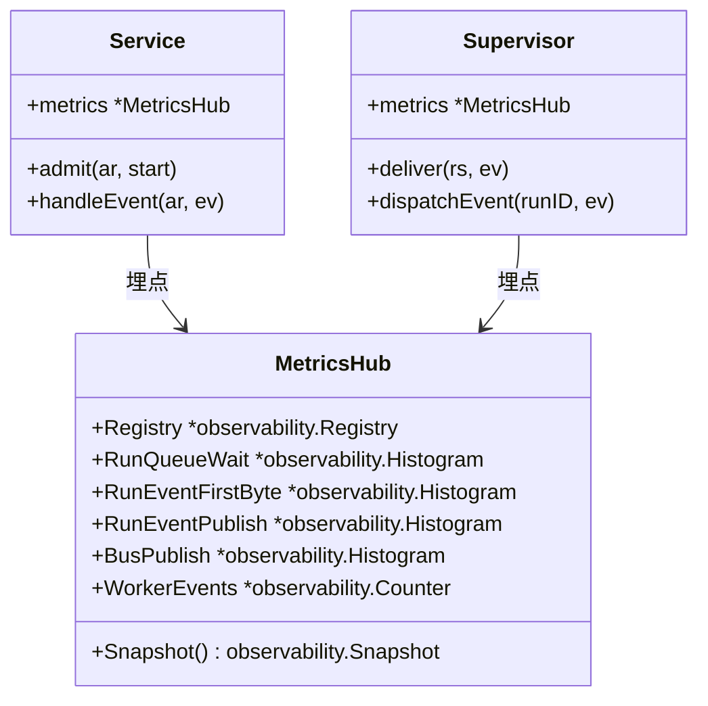
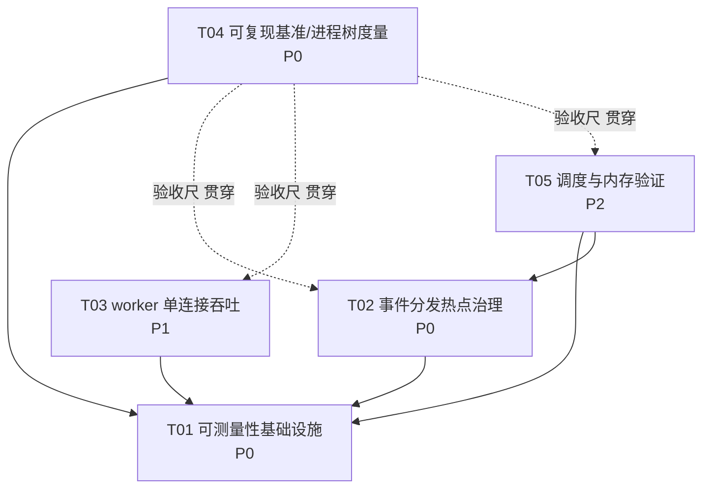

# gogosling 性能与算法优化 · 增量系统设计

> 定位：在既有架构（权威见 `docs/architecture.md`）之上做**增量**优化。已扎实的模块（调度优先级、JSON-RPC 协议、推理循环、排队轻量化）主体不动；重点是**补齐可测量性** + **低风险、可证明的性能改进**。
> 原则：不破坏依赖方向（靠 `internal/archcheck` 强制）、不破坏安全不变量（凭据不进日志/事件、工具副作用过审批+沙箱、排队不预读历史/不持凭据）、不做作弊式优化（不跳过审批、不丢未保存内容、不用百分比模拟进度）。

## 与已合并优化的关系

2026-10-13 至 10-14 已合并的改动不在本方案里重复做：

- `0a72c29` 减少流式解析和历史消息渲染。总线在历史有缺口时不再扫描整个回放缓冲，慢订阅者在 `Publish` 里直接标记丢失并移除。`Publish` 仍在持有 `b.mu` 时向订阅者发送。
- `5bf5530`、`df748a0`、`d6beda6` 降低草稿、工具快照、长任务渲染和空闲扫描的开销，并保留未保存内容的回收边界。
- `d272451` 简化工作台层级，加快菜单和面板反馈。

这些提交没有接入下面的 M1–M5。`handleEvent` 仍在持有 `ar.mu` 期间调用 `publishRun`。本方案仍从测量开始，不把上述提交当成已经证明流畅度的基线。

---

## Part A：系统设计

### 1. 实现 Approach（优化目标与可测量指标）

**核心判断**：当前系统不是"某处很慢"，而是**没有任何"可测量基线"**。`internal/observability` 已提供 `Registry/Counter/Gauge/Histogram/Tracer`，但业务层零接线（grep `observability.` 仅命中 `cmd/` 两处日志/路径）。因此第一步不是"改快"，而是"能测量"。这直接对应 `ROADMAP.md` §"Help measure the difference" 的 `measure the whole process tree` 要求。

**"流畅度"的 5 个可测量指标**（均落在真实链路，给出埋点位置与采集点）：

| # | 指标 | 定义 | 埋点位置（文件·函数） | 采集方式 |
|---|---|---|---|---|
| M1 | **排队延迟 P95** `run_queue_wait_seconds` | 用户发起 → 拿到执行槽的等待 | `internal/session/admission.go`·`admit`/`takeReadyLocked`（已有 `enqueuedAt`） | Histogram，秒 |
| M2 | **事件首字节延迟** `run_event_first_byte_seconds` | worker `emit` → `sink` 投递（supervisor→handleEvent） | `internal/engine/supervisor.go`·`deliver`/`dispatchEvent` | Histogram（ms） |
| M3 | **事件分发/发布耗时** `run_event_publish_seconds`、`bus_publish_seconds` | `handleEvent` 持 `ar.mu` 全程、`Bus.Publish` 扇出耗时 | `internal/session/run.go`·`handleEvent`；`internal/event/bus.go`·`Publish` | Histogram |
| M4 | **长会话内存增长** | 单 run 活跃状态 `activeRun.text`（`strings.Builder`）在高频 delta 下的驻留 | `internal/session/run.go`·`handleEvent`(写 `ar.text`) / `state.go` | Gauge + 进程树 RSS |
| M5 | **worker 单连接吞吐** `worker_rpc_events_total`、单连接事件速率 | 单 conn 承载全部 run 的 JSON-RPC 事件速率 | `internal/engine/conn.go`·`readLoop`/`dispatch`；`supervisor.go`·`deliver` | Counter + 速率 |

**为什么是这些**：M1 回答"我按下发送后多久真正开始跑"；M2 回答"模型第一个字多久到界面"；M3 定位分发链路的锁竞争（现状 `handleEvent` 全程持 `ar.mu` 且内嵌 `s.publishRun` → 全局 `b.mu`，高频 delta 下是串行化热点）；M4 对应长时间会话的内存增长；M5 反映单连接吞吐上限。**没有 M1–M5 就无法证明任何"流畅度"改进**，这是本方案的前置约束。

### 2. 文件清单（增量，按任务分组）

```
新增：
  internal/metrics/hub.go              # 新增轻量指标中枢（domain 层），import observability/model
  internal/metrics/metrics.go          # M1–M5 指标定义与注册
  tests/bench/bench_test.go            # e2e 基准（进程树度量，build tag e2e）
  tests/bench/README.md                # 复现步骤、记录字段（OS/硬件/revision/负载）

修改：
  internal/session/admission.go        # M1 排队延迟埋点
  internal/session/run.go              # M3 handleEvent 分发耗时；M4 text 驻留观测
  internal/event/bus.go                # M3 发布扇出耗时（可选：去全局锁热点）
  internal/engine/supervisor.go        # M2 首字节延迟；M5 事件吞吐计数
  internal/engine/conn.go              # M5 readLoop 事件计数
  internal/server/server.go            # 暴露 GET /api/v1/metrics（受 Bearer 保护，不豁免）
  worker/src/gogosling_worker/runtime/loop.py   # 方向二：emit 合并/吞吐优化（谨慎）
  worker/tests/harness.py               # 基准用 harness 扩展
```

### 3. 数据结构与接口

见 `docs/class-diagram.mermaid`。要点：新增 `internal/metrics` 作为 **domain 层**，只 `import observability`（leaf）+ `model`（leaf），**不 import session/engine/server**（保持向内依赖，archcheck 通过）；`session`/`engine` 反向 `import metrics`（domain→domain 同层允许）。



### 4. 程序调用流（关键路径）

见 `docs/sequence-diagram.mermaid`。核心链路：

`Send → admit(M1 排队) → StartRun → worker emit → conn.readLoop → supervisor.dispatchEvent/deliver(M2 首字节) → session.handleEvent(M3 分发) → Bus.Publish(M3 扇出) → Subscription.C → server.pump(批次) → UI`

### 5. 不明确之处与假设

- **基线口径未定**：`measure the whole process tree` 的"空闲/长会话/多 agent/取消"场景参数（并发数、消息量、模型速度）由 T1 基准脚本先固定，后续优化以此为对照。
- **`/metrics` 是否豁免认证**：架构 §6.1 说"除 `/healthz` 外全部要求 Bearer"，故 **`/metrics` 不豁免**，需 token，避免新增无鉴权面。
- **是否引入 OTel SDK**：暂不引入。理由：先用 `observability.Registry`（已提供 Histogram/Counter）建立进程内基线，避免一次性引入 SDK 造成大面积改动；`semconv.go` 已对齐 OTel 的 GenAI 属性，日后接入只需替换实现。
- **内存治理边界**：`activeRun.text` 用于失败/取消时保留部分输出（安全相关），**不得简单丢弃**；只做"观测"为主，治理需保留 partial 语义。

---

## Part B：任务分解

### 6. 依赖包

```
（无新增第三方依赖；全部复用 internal/observability 已提供的 Registry/Histogram/Counter/Tracer）
- 仅测试基准可能用到标准库：testing / runtime/pprof / os/exec / sync
```

### 7. 任务列表（≤5，按依赖）

| ID | 任务 | 源文件（增/改） | 依赖 | 优先级 |
|---|---|---|---|---|
| **T01** | **可测量性基础设施**：新增 `internal/metrics`，在 session/engine/event 埋 M1–M5，暴露 `/api/v1/metrics`（Bearer 保护） | 新增 `internal/metrics/hub.go`/`metrics.go`；改 `session/admission.go`、`session/run.go`、`event/bus.go`、`engine/supervisor.go`、`engine/conn.go`、`server/server.go` | 无（基础设施先行） | **P0** |
| **T02** | **事件分发热点治理**：优化 `Bus.Publish` 全局锁扇出 + `handleEvent` 锁粒度，降低首字节 P99（先用 T01 的 M2/M3 量化，确认热点再动） | 改 `event/bus.go`、`session/run.go` | T01 | **P0** |
| **T03** | **worker 单连接吞吐**：loop.py emit 合并/批量（保序、保首字节即时性），提升 M5 吞吐、降低 M2 尾部 | 改 `worker/.../runtime/loop.py`、`worker/tests/harness.py` | T01 | **P1** |
| **T04** | **可复现基准与进程树度量**：e2e 基准脚本，记录 OS/硬件/revision/模型/负载，冻结基线口径 | 新增 `tests/bench/bench_test.go`、`tests/bench/README.md`；改 `worker/tests/harness.py` | T01 | **P0** |
| **T05** | **调度与内存验证（可选）**：用 M1 排队 P95 验证优先级/久候提升策略；用 M4 观测长会话 `text` 驻留 | 改 `session/admission.go`、`session/run.go`、`session/state.go` | T01（T02 之后） | **P2** |

> 依赖说明：T02/T03/T05 都**只依赖 T01**（先能测量），彼此尽量独立，便于并行与验证。T04 基准是"验收尺"，贯穿 T02–T05。

### 8. 共享知识（给工程师的横切约束）

- **依赖方向**：`internal/metrics`（新增 domain）只能 import `observability`/`model` 等 **leaf**；`session`/`engine` 可 import `metrics`（同层 domain）。**任何反向 import（metrics→session/engine）会让 `internal/archcheck` 失败**。
- **认证**：新增 `/api/v1/metrics` **必须要求 Bearer**，不加入 `/healthz` 豁免名单；受同一 `Host`/`Origin` 约束。
- **指标命名**：沿用 `observability` 的 `snake_case`（`metricName` 正则 `^[a-z_][a-z0-9_]*$`），不得用点号。
- **不变量**：埋点与优化**不得**让凭据进日志/事件；不得跳过审批/丢未保存内容；不得用百分比伪造进度；排队仍不预读历史、不持凭据副本。
- **性能口径**：任何"更快"的结论都要给出**同等负载下**的 M1–M5 前后对照与进程树资源（peak/steady RSS、CPU time、磁盘增长、队列等待、延迟、取消后释放），不得脱离测量下结论。

### 9. 任务依赖图



### 10. 风险与边界（三项优化方向）

**方向一：补齐可测量性 + 分发去锁竞争（T01+T02）**
- 现状问题：`Bus.Publish` 在持有全局 `b.mu` 时对所有订阅者 `select` 扇出；`handleEvent` 全程持 `ar.mu` 且内嵌 `publishRun`（再抢 `b.mu`）。高频 delta 下 `b.mu`/`ar.mu` 成为串行化点。
- 参考开源路径：Go 标准库/生态的**非阻塞扇出 + 慢订阅者隔离**思路（如 `net/http` 的 flusher 背压、`sync` 的 `Once`/`RWMutex` 读多写少拆分），或对标 **NATS/JetStream 的订阅缓冲水位**。**不引入第三方锁库**。
- 影响：新增 `internal/metrics`（domain），不破坏 archcheck；`observability` 仍是 leaf。
- 风险/边界：改变总线分发语义时**必须保证 Seq 有序、慢订阅不阻塞发布者**；首字节即时性不得降低。

**方向二：worker 单连接吞吐（T03）**
- 现状：`loop.py` 每个 delta 一条 JSON-RPC notification；单 conn 串行 readLoop。
- 参考开源路径：OpenAI/Agent SDK 的**增量合并/批量刷写**，Go 侧 `bufio.Writer` 批量写思路；Python 侧 `asyncio` 单写者队列（单 writer 串行化 stdout 写入，避免交错）。
- 影响：只改 worker 循环 + 可选 supervisor 批量，不改协议（`run.event` 语义不变）。
- 风险/边界：**必须保序、必须首字节即时**；合并窗口过小无效、过大伤流畅度——用 M2 P99 定窗口。

**方向三：调度与内存（T05，可选）**
- 现状：`takeReadyLocked` 已是 O(n≤32) 线性扫描（非瓶颈，慎改）；`activeRun.text` 驻留。
- 参考开源路径：`golang.org/x/sync/semaphore`（若日后多工作区权重调度）作为**可选**演进；内存驻留用"观测 + 保留 partial 语义下的上限/释放"策略。
- 影响：不新增包；`session` 内部调整。
- 风险/边界：**不简化排队优先级语义**（用户优先、久候提升、工作区串行），不改安全不变量。

---

## 附：落地建议顺序

1. 先做 **T01 + T04**：先有尺子和基线，才谈优化（避免"凭感觉调优"）。
2. 依据 T01 的 M2/M3 数据，再做 **T02**；依据 M2/M5，再做 **T03**。
3. **T05** 仅在数据支持时投入（多数情况已是良好实现，克制优先）。
